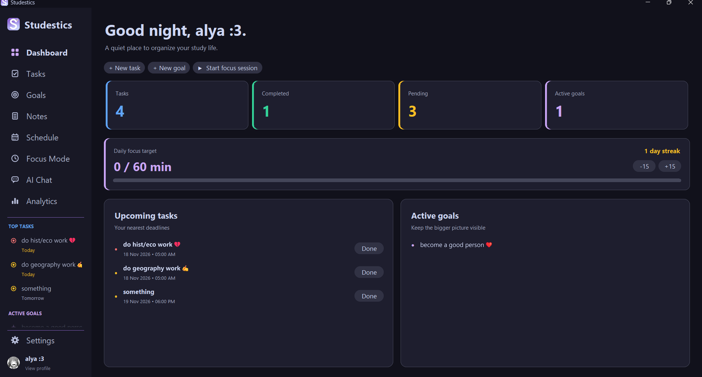
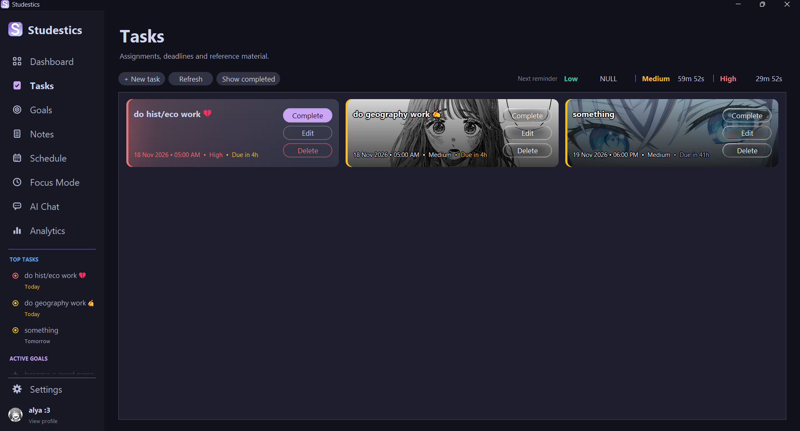
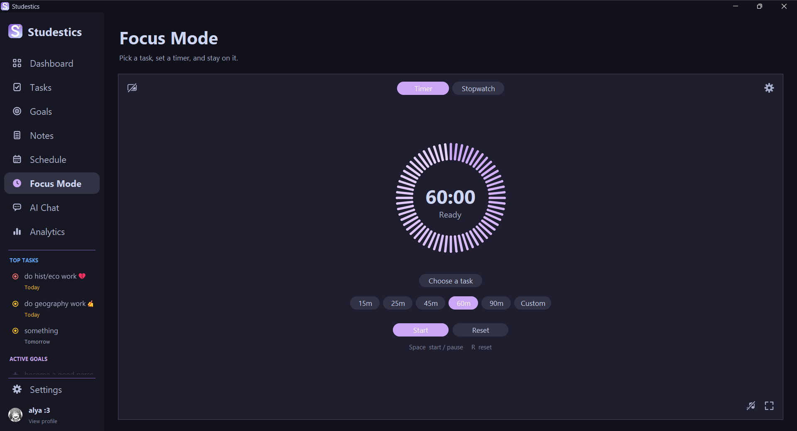
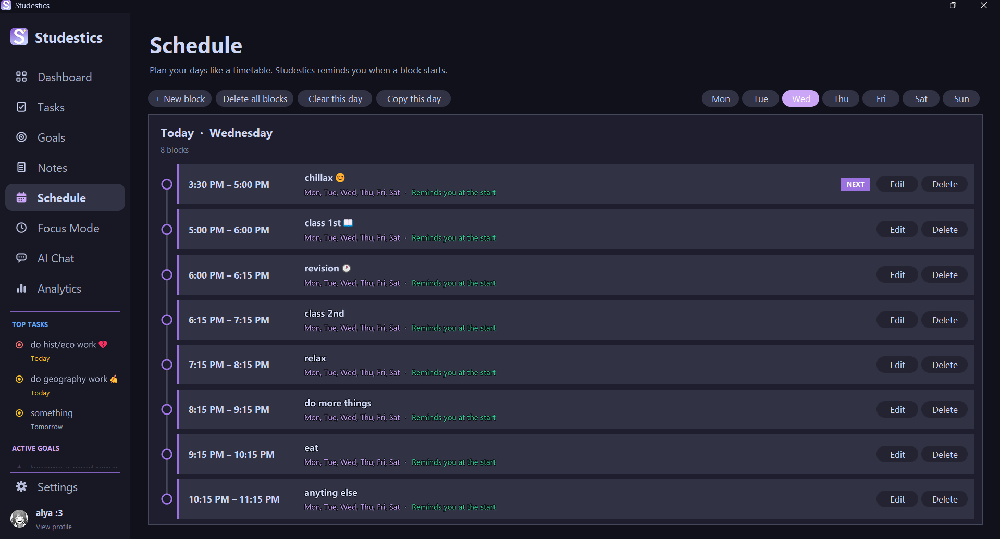
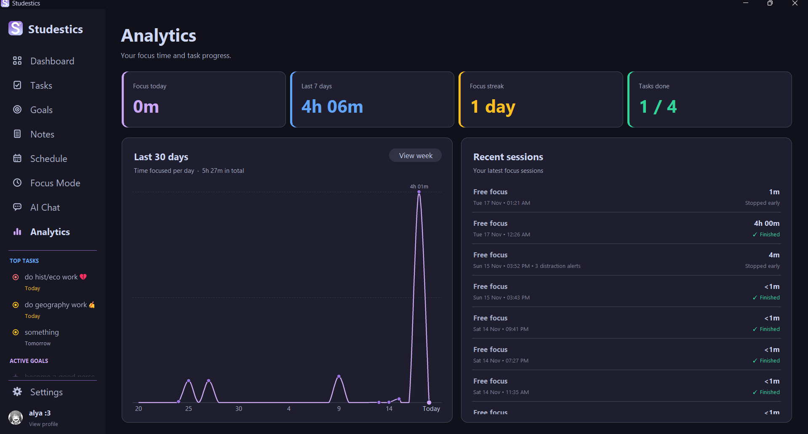

<div align="center">


# Studestics

**A dark, rounded study planner for Windows.**
Tasks, goals, notes, a schedule, a focus timer and an AI study buddy, in one small app.

[Latest release](https://github.com/alyavoidx/studestics/releases/latest) | [Report a bug](https://github.com/alyavoidx/studestics/issues) | [Changelog](https://github.com/alyavoidx/studestics/releases)


<br>



</div>

> [!CAUTION]
> The only official place to download Studestics is this GitHub repository.
> Any other website, repository or account offering downloads or claiming to be us is not controlled by us. Do not download from them.

<br>

## Contents

- [Install](#install)
- [Features](#features)
- [Screenshots](#screenshots)
- [Keyboard shortcuts](#keyboard-shortcuts)
- [FAQ](#faq)
- [Running from source](#running-from-source)
- [Building the exe](#building-the-exe)
- [Contributors](#contributors)
- [License](#license)

<br>

## Install

1. Download `Studestics.exe` from the [latest release](https://github.com/alyavoidx/studestics/releases/latest).
2. Run it. There is nothing to set up, and a short tour walks you through the app the first time.
3. Studestics keeps itself up to date: when a new version is out you get an **Update now** button inside the app.

> [!IMPORTANT]
> Studestics is **Windows only** (Windows 10 and above). Your data stays on your computer in a local database.

> [!NOTE]
> Windows SmartScreen may warn about an app it hasn't seen much. Click **More info**, then **Run anyway**. You can also read every line of the source in this repository.

<br>

## Features

### Plan

| | |
|---|---|
| **Tasks** | Deadlines, priorities (Low / Medium / High), descriptions, photo cards, and a "Due in" label on every card. Completed tasks live on their own page. |
| **Reminders** | Repeating reminders with a different pace per priority, or a custom interval per task. A *Next reminder* strip shows the time left for each priority. |
| **Goals** | Longer-term goals with their own cards. |
| **Notes** | A clean text editor. Hit **Quiz me** and Studestics turns a note into a quiz with 1 to 50 questions. |
| **Schedule** | Weekly blocks with repeating days, a running-block highlight, and **Copy this day**. |

### Focus

| | |
|---|---|
| **Timer** | Presets or your own minutes and seconds, linked to a task. |
| **Pomodoro** | Focus rounds with short and long breaks, and a break limit (5 to 30 min) in Settings so breaks stay breaks. |
| **Stopwatch** | Count up with laps. The ring fills through each lap, and the lap list shows fastest and slowest. |
| **Floating clock** | A small always-on-top timer in several styles that appears when you leave the app. |
| **Distraction nudges** | A gentle reminder if you wander off to something else during a session. |
| **Keep awake** | Your PC won't sleep in the middle of a session. |

### Understand

| | |
|---|---|
| **Dashboard** | Today at a glance, with a daily focus target and a "Goal reached" state. |
| **Analytics** | Charts of your focus time, tasks and habits. |
| **Profile** | Your photo, streaks, totals and a 7-day chart. |
| **AI Chat** | Ask questions about your studies. It uses Google Gemini and your own free API key, which you paste in during the first-run tour. |

### Make it yours

- Themes: Purple, Catppuccin, Matcha, Ocean, Rose and Light
- Make a theme from a picture, or load a theme `.css` file
- Timer backgrounds, including GIFs
- Liquid-glass buttons that refract the picture behind them
- Alarm sounds (presets or your own file)
- Smooth start-up animation, which you can turn off
- Lives in the tray, starts quietly at sign-in, and only ever runs one copy
- Emoji in task and goal titles (type `:tick` and friends)

<br>

## Screenshots

<div align="center">

| Tasks | Focus |
|:---:|:---:|
|  |  |

| Schedule | Analytics |
|:---:|:---:|
|  |  |

</div>

<br>

## Keyboard shortcuts

| Where | Keys | Does |
|---|---|---|
| Focus page | `Space` | Start / pause |
| Focus page | `R` | Reset |
| Stopwatch | `L` | Lap |
| Pop-ups | `Enter` / `Esc` | Confirm / close |
| Pop-ups | Arrow keys | Move between options |
| Custom focus time | `Enter` | Set the timer and close the row |

<br>

## FAQ

<details>
<summary><b>Is it free?</b></summary>

Yes. The AI features need a free Google Gemini API key, which you create yourself.
</details>

<details>
<summary><b>Where is my data stored?</b></summary>

In a local database on your computer. Settings has buttons to delete all tasks, all goals, or all user data (your API key is kept).
</details>

<details>
<summary><b>Is there a Mac, Linux or Android version?</b></summary>

No. Studestics is built for Windows only.
</details>

<details>
<summary><b>Does the AI see my notes?</b></summary>

Only when you ask it to, for example when you use **Quiz me** on a note. Those requests go to Google Gemini through your own API key.
</details>

<details>
<summary><b>The window looks cut off or the sidebar is crowded.</b></summary>

Make the window a little taller, or maximise it. The sidebar lists scroll when there isn't enough room, and the app remembers your window size.
</details>

<details>
<summary><b>I found a bug.</b></summary>

Please [open an issue](https://github.com/alyavoidx/studestics/issues) with a screenshot or a short video. It helps a lot.
</details>

<br>

## Running from source

You need Python 3.10 or newer on Windows.

```powershell
git clone https://github.com/alyavoidx/studestics.git
cd studestics
pip install pillow pystray google-genai
python Studestics.py
```

## Building the exe

```powershell
pip install pyinstaller
pyinstaller --onefile --noconsole --name Studestics Studestics.py
```

The exe is created in `dist/`. Keep the `VERSION` line at the top of `Studestics.py` equal to the release tag, because the built-in updater compares them.

<br>

## Contributors

<a href="https://github.com/alyavoidx/studestics/graphs/contributors">
  
</a>

<sub>Styled after contrib.rocks</sub>

<br>

## License

See [LICENSE](LICENSE).

<div align="center">
<br>

**Leave a star if you like the project.**

</div>
